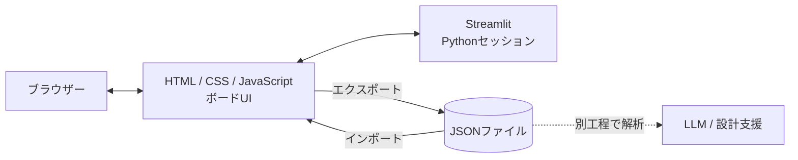

# Event Storming Board

**イベントから設計を導く。**  
ドメインエキスパートの見識を可視化・構造化し、クラウドネイティブなプラットフォーム設計につなげるための、**Streamlit製 Event Storming モデリングボード**です。

Event / Command / Read Model の色付き付箋と、Aggregate / Policy / Actor / Hot Spot / External System の**意味を持つアイコン**を組み合わせます。業務の全体像を見渡すモードと、入出力の関係を確認するモードを切り替えられることが特徴です。作成したモデルはJSONとして保存でき、外部のLLMや設計プロセスに引き継げます。

> [!NOTE]
> 本リポジトリは、Event Storming の実践とクラウドネイティブ設計への展開を検証するためのプロトタイプです。クラウド構成図やIaCコードを自動生成する機能は、現行アプリには含まれていません。

## 目次

- [Event Stormingとは](#event-stormingとは)
- [スクリーンショット](#スクリーンショット)
- [従来型ホワイトボードとの違い](#従来型ホワイトボードとの違い)
- [主な機能と記法](#主な機能と記法)
- [クイックスタート](#クイックスタート)
- [5分で試す](#5分で試す)
- [JSONデータ形式](#jsonデータ形式)
- [アーキテクチャーと依存関係](#アーキテクチャーと依存関係)
- [制約と今後の方向性](#制約と今後の方向性)
- [参考資料](#参考資料)
- [公開時の注意事項](#公開時の注意事項)

## Event Stormingとは

**Event Storming** は、業務担当者とエンジニアが一緒に、業務で**起きた出来事（Domain Event）**を付箋に書き出し、時間の流れに沿って並べながら、業務の仕組み・例外・未解決の論点を発見する協調的なモデリング手法です。

例えばオンラインショップなら、「注文が作成された」「決済が承認された」「商品が発送された」などがイベントです。そこに「決済を要求する」という**指示（Command）**や、「決済失敗時に注文をキャンセルする」という**ルール（Policy）**を追加すると、業務の振る舞いを具体的に議論できます。

このボードは、その議論を**付箋だけの図で終わらせず、機械可読な関係モデルとして残す**ことを目指しています。

## スクリーンショット

**サンプル：ECサイトの注文から発送まで**

### 1. 全体像：矢印なし


イベント、指示、参照情報、業務ルールなどの位置関係に集中できます。初期の業務理解や、広い範囲を俯瞰する際に向いています。

### 2. 関係性：矢印あり


必要に応じて矢印を表示し、**何が指示を受け、何がイベントを発生させるか**を確認できます。矢印の常時表示だけでなく、特定の意味的ノードを選択して関連要素に注目することもできます。

## 従来型ホワイトボードとの違い

Mural、Miro、FigJamなどの汎用ホワイトボードは、自由に付箋や線を配置できる点が強みです。本ツールは、それらの代替というよりも、**Event Storming 固有の意味と接続ルールに焦点を当てた専用ボード**です。

| 観点 | 汎用ホワイトボードによるEvent Storming | Event Storming Board |
| --- | --- | --- |
| 業務要素 | 色や配置の意味を参加者が共有 | 付箋・アイコンに種類を明示 |
| 関係性 | 線や図形を自由に描画 | Aggregate / Policy / External System に入出力を設定 |
| 俯瞰と詳細 | 表示倍率や手動の図面整理を活用 | 全矢印の表示切替、関連要素の強調、フォーカス移動 |
| 後続の設計 | 図面を読み解いて次工程へ引き継ぐ | JSONに要素・関係を保存して外部解析へ引き継ぐ |

※汎用ホワイトボードにもテンプレート・拡張機能・データ連携機能があります。上表は一般的な使い方と本ツールの設計意図の比較です。

## 主な機能と記法

### オブジェクトの種類

| 種類 | 表示 | 役割 |
| --- | --- | --- |
| Domain Event | 🟧 オレンジの付箋 | 業務で既に起きた出来事 |
| Command | 🟦 ブルーの付箋 | 業務上の指示・要求 |
| Read Model | 🟩 グリーンの付箋 | 参照・閲覧するための情報 |
| Aggregate | 🏛️ 建物アイコン | 状態と整合性を扱うまとまり |
| Policy | ⚙️ 歯車アイコン | イベントに応じて処理を開始するルール |
| Actor | 👤 人物アイコン | 人・役割などの関係者 |
| Hot Spot | 🔥 炎アイコン | 未確定事項、課題、検討箇所 |
| External System | 📡 アンテナアイコン | 外部サービス・システムとの連携境界 |

### 入出力のルール

```text
Command      ──> Aggregate       ──> Domain Event
Domain Event ──> Policy          ──> Command
Command      ──> External System ──> Domain Event
```

Aggregate、Policy、External System は、ダブルクリックで複数の入力・出力要素とルール／メモを設定できます。表示モードでダブルクリックすると、それらの関係をMermaidフローチャートで確認できます。

> これらの接続ルールは本ツールがモデリングを分かりやすくするために採用した制約であり、Event Storming のすべての表記法を網羅するものではありません。Bounded Context の境界を直接作成する専用オブジェクトは、現行版にはありません。

### 操作一覧

| 操作 | 使い方 |
| --- | --- |
| 作成 | 上部パレットのアイコンをボードへドラッグ＆ドロップ。クリックによる追加も可能 |
| 移動・編集 | 付箋やノードをドラッグ。編集モードでダブルクリックすると詳細を編集 |
| 拡大・縮小 | ボード上のマウスホイール、または倍率スライダー（5〜250%） |
| ボード移動 | 余白をドラッグしてパン。`Shift`＋ホイールで横スクロール |
| 関係の確認 | ノード選択時の関係強調、または「全矢印」のON/OFF |
| 表示モード | 要素をダブルクリックして説明カードを開く。`← ↑ ↓ →`で隣接要素へ、`Space`で説明切替、`Esc`で終了 |
| 重なり順 | Z順の前面・背面・最前面・最背面操作 |
| 編集履歴 | Undo / Redo |
| 保存・読込 | ブラウザーからJSONをダウンロード／読み込み |
| 画像出力 | 「PNG」でボード全体のスナップショットを保存 |

付箋本文内でテキストを選択したい場合は `Alt` を押しながらドラッグしてください。

## クイックスタート

### 必要な環境

- Python **3.10以降を推奨**
- [Streamlit](https://streamlit.io/) **1.51以上・2未満**（`st.components.v2.component` を使用）
- ChromeまたはEdgeなどのモダンブラウザー

Pythonパッケージは `requirements.txt` からインストールします。アプリケーションの起動にNode.jsのビルドや別のフロントエンドプロジェクトは必要ありません。

### Windows / PowerShell

```powershell
py -m venv .venv
.\.venv\Scripts\Activate.ps1
python -m pip install -r requirements.txt
python -m streamlit run event_storming_app.py
```

PowerShellの実行ポリシーにより有効化できない場合は、仮想環境のPythonを直接実行できます。

```powershell
.\.venv\Scripts\python.exe -m pip install -r requirements.txt
.\.venv\Scripts\python.exe -m streamlit run event_storming_app.py
```

### Linux / WSL / macOS

```bash
python3 -m venv .venv
source .venv/bin/activate
python -m pip install -r requirements.txt
python -m streamlit run event_storming_app.py
```

起動後、ターミナルに表示されたURL（通常は `http://localhost:8501`）をブラウザーで開きます。

### リポジトリーの想定構成

```text
event-storming-board/
├── README.md
├── event_storming_app.py
├── requirements.txt
├── docs/
│   └── images/
│       ├── ec-shop-overview.png
│       └── ec-shop-relations.png
└── samples/
    ├── ec_shop_order_shipping_sample.json
    └── event_storming_ride_booking_sample.json
```

## 5分で試す

1. アプリを起動し、上部の **「読込」** から `samples/ec_shop_order_shipping_sample.json` を選択します（現在のボードは置き換わります）。
2. **「全体」** で全要素を表示し、オレンジのイベントとブルーのコマンドを追います。
3. **「全矢印」** を切り替えて、Aggregate・Policy・External System と付箋の関係を比較します。
4. **「表示」** に切り替え、歯車（Policy）などをダブルクリックします。矢印キーで隣接オブジェクトへ移動し、説明カードを確認します。
5. **「編集」** に戻り、任意のPolicyをダブルクリックして入出力を変更します。最後に **「保存」** でJSONを、**「PNG」** で図を出力します。

サンプルには配車業務（`samples/event_storming_ride_booking_sample.json`）も含まれます。

## JSONデータ形式

ボードの保存形式は、トップレベルに `title` と `notes` を持つJSONです。各要素は `eventKind`、位置、タイトル、内容などを持ち、関係は `inputIds` と `outputIds` にIDの配列として保存します。

```json
{
  "title": "注文受付",
  "notes": [
    {
      "id": "cmd_place_order",
      "eventKind": "command",
      "title": "注文を確定する",
      "text": "購入者が注文を確定する",
      "x": 100,
      "y": 160
    },
    {
      "id": "agg_order",
      "eventKind": "aggregate",
      "title": "注文",
      "x": 330,
      "y": 160,
      "inputIds": ["cmd_place_order"],
      "outputIds": ["evt_order_created"],
      "ruleText": "注文番号は一意である"
    },
    {
      "id": "evt_order_created",
      "eventKind": "domain_event",
      "title": "注文が作成された",
      "x": 560,
      "y": 160
    }
  ]
}
```

この形式は、LLMや独立した解析スクリプトが、要素一覧・業務フロー・未確定事項・サービス境界候補を検討するための**入力データ**として利用できます。解析やクラウド構成への変換は、本アプリの外部で実施する想定です。

## アーキテクチャーと依存関係



- **UI**：HTML・CSS・JavaScriptを `event_storming_app.py` に埋め込み、[Streamlit Custom Components v2](https://docs.streamlit.io/develop/api-reference/custom-components/st.components.v2.component) で表示します。
- **モデル**：ボードの要素と関係をJSONで保持し、Streamlitのセッションと同期します。永続データベースやリアルタイム共同編集サーバーは含みません。
- **外部ライブラリー**：関係フローチャートの描画時に [Mermaid 11](https://mermaid.js.org/)、PNG出力時に [html-to-image 1.11.11](https://github.com/bubkoo/html-to-image) を `cdn.jsdelivr.net` から動的に読み込みます。**これらの機能にはCDNへのネットワーク接続が必要です。**

## 制約と今後の方向性

**現行版の制約**

- リアルタイム共同編集、認証・権限管理、サーバー側の永続保存は未実装です。
- Bounded Context の自動抽出、マイクロサービス分割、AWSリソースやIaCコードの自動生成は未実装です。
- JSONインポートは現在のボードを置き換えます。作業途中のデータは事前にJSON保存してください。
- CDNへのアクセスが制限される環境では、Mermaid表示やPNG保存が利用できない場合があります。

**発展させたい方向性**

- JSONを中間モデルへ正規化し、イベント・責務・関連性を一貫した形式で扱う。
- Bounded Context やマイクロサービス境界の検討をLLMで支援する。
- イベント駆動設計、サーバーレス設計、AWS SAMやDiagram as Codeなどの次工程に引き継ぐ。

> **設計原則：** ボード自体は対話と可視化に集中し、高度な分析やコード生成はJSONを受け取る外部ツールで実施します。

## 参考資料

- [EventStorming 公式サイト](https://www.eventstorming.com/) — 提唱者Alberto Brandoliniの方法論と資料
- [Streamlit Custom Components v2](https://docs.streamlit.io/develop/concepts/custom-components/components-v2) — 本アプリのUI実装に使用
- [Miro Event Storming テンプレート](https://miro.com/ja/templates/event-storming/) — 汎用ホワイトボードとの比較参考

## 公開時の注意事項

- **ライセンス**：再利用・改変・再配布を許諾する場合は、公開者が利用条件を決めて `LICENSE` ファイルを追加してください。このREADMEは特定のオープンソースライセンスを自動的に付与するものではありません。
- **公開情報**：実在の顧客情報、機密性のある業務ルール、社内システム構成などを含むJSONやスクリーンショットをコミットしないでください。
- **運用**：インターネット公開や組織内の共用環境へデプロイする場合は、認証、アクセス制御、依存ライブラリーの管理、データ保持方針を別途設計してください。
- **検証**：公開前に、使用するOS・ブラウザーでドラッグ操作、関係編集、JSON入出力、PNG保存などの動作を確認してください。

---

**イベントから設計を導く。**  
業務の理解を、クラウドネイティブな設計判断につなげるための対話ボードです。
